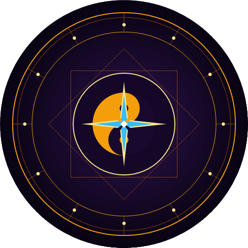
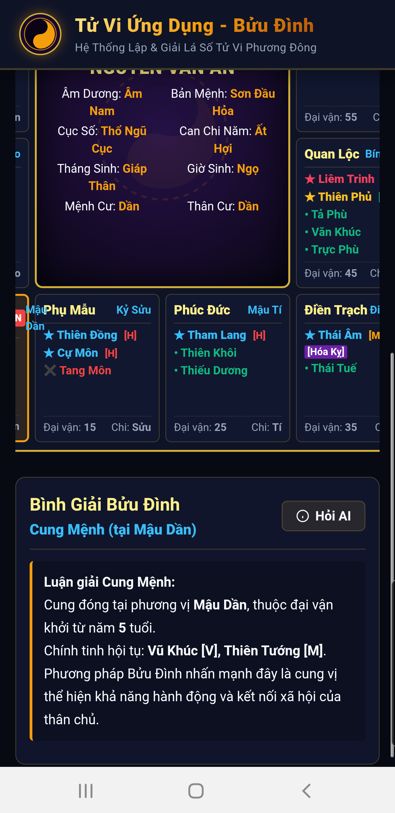
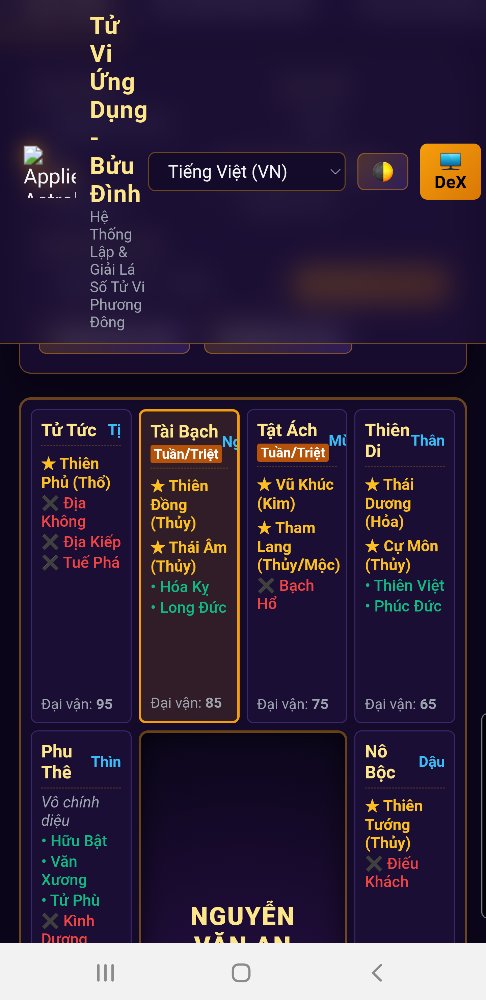
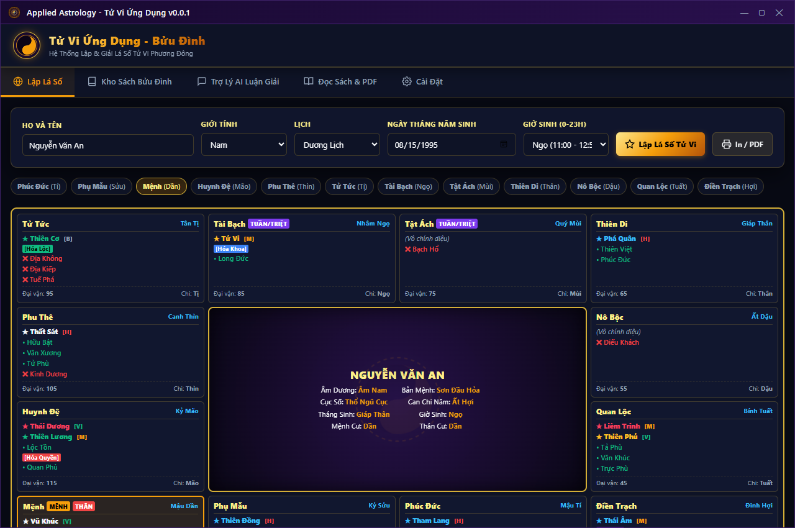
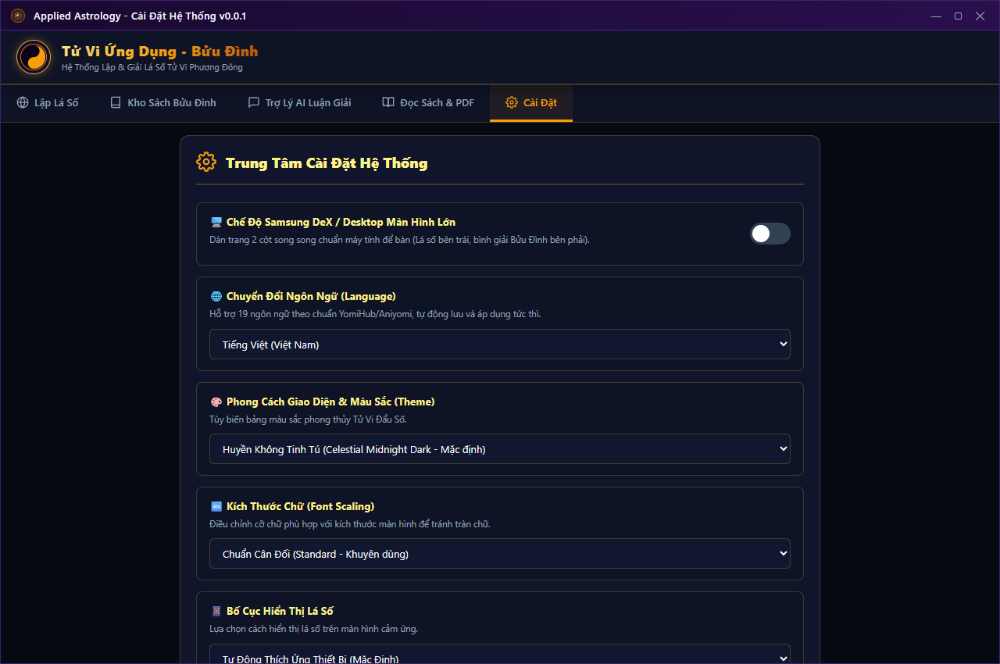
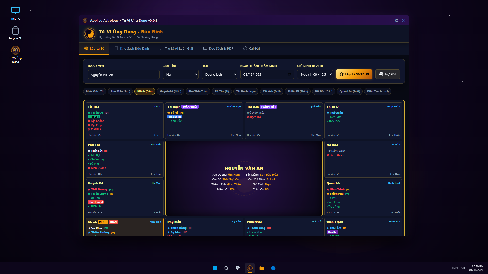

# Ứng Dụng Tử Vi Ứng Dụng (Applied Astrology) - Phiên bản 0.0.1

  
   
  <b>Kế thừa & Nâng cấp Hiện đại hóa từ Tác phẩm "Tử Vi Ứng Dụng - Bửu Đình"</b>
   
  <i>Hỗ trợ đa nền tảng: Android 6.0+ (API 23+) & Windows 7 trở lên (x64, x86, ARM)</i>

---

## 🌟 Giới thiệu Tổng quan

**Applied Astrology (Tử Vi Ứng Dụng)** phiên bản **0.0.1** là bước đột phá công nghệ nhằm kế thừa, số hóa và hiện đại hóa toàn bộ kho tàng học thuật Tử Vi từ phần mềm nguyên bản định dạng Flash SWF (*Tử Vi Ứng Dụng - Bửu Đình.swf*) sang nền tảng ứng dụng đa thiết bị thế hệ mới.

Ứng dụng đáp ứng trọn vẹn 22 nhóm tính năng cốt lõi (dựa trên tiêu chuẩn hệ sinh thái YomiHub / Aniyomi), cho phép người dùng lập lá số Tử Vi chuẩn xác, tra cứu kho tàng hơn 18,000 bài luận giải kinh điển, tương tác cùng Trợ lý AI luận đoán vận mệnh, đọc tài liệu PDF chuyên khảo và bảo mật kết nối.

---

## 🎨 Thiết kế Biểu trưng (Logo) Độc quyền

Logo của ứng dụng được nghiên cứu và thiết kế dựa trên các nguyên lý cốt lõi của Đạo học và Tử Vi Đẩu Số:
1. **Thái Cực Lưỡng Nghi (Âm Dương)**: Biểu thị sự vận động không ngừng của trời đất, căn nguyên của vạn vật và nguyên lý Âm Dương thuận lý / nghịch lý trong Tử Vi.
2. **Bát Quái Tiên Thiên (Càn, Khảm, Cấn, Chấn, Tốn, Ly, Khôn, Đoài)**: Thể hiện quy luật biến dịch không gian - thời gian, phân định phương vị phong thủy và cung vị địa bàn.
3. **Vòng 12 Cung Địa Bàn (Tý đến Hợi)**: Khắc họa trật tự 12 cung số định mệnh của đời người.
4. **Sao Tử Vi (Đế Tinh Cực Tinh)**: Ánh sáng tím huyền diệu (Tử Vi Tinh Tọa) rực sáng nơi trung tâm thiên bàn biểu trưng cho sự tôn quý, thông tuệ và chỉ lối dẫn đường.

Bộ nhận diện logo được kết xuất đầy đủ ở các kích thước tiêu chuẩn: SVG vector, PNG (1024x1024, 512x512, 192x192, 128x128, 48x48) và biểu tượng Windows ICO đa tầng.

---

## 🚀 Các Tính Năng Trọng Tâm

### 1. Thuật Toán Lập Lá Số Thiên Bàn & Địa Bàn Chuẩn Xác
- Chuyển đổi Dương lịch sang Âm lịch, tính toán Can Chi năm, tháng, ngày, giờ chính xác.
- Xác định Âm Dương Nam Nữ, Nạp Âm Ngũ Hành bản mệnh, Cục số (Thủy Nhị Cục, Mộc Tam Cục, Kim Tứ Cục, Thổ Ngũ Cục, Hỏa Lục Cục).
- An sao chuẩn xác: 14 Chính tinh (Tử Vi, Liêm Trinh, Thiên Đồng, Vũ Khúc, Thái Dương, Thiên Cơ, Thiên Phủ, Thái Âm, Tham Lang, Cự Môn, Thiên Tướng, Thiên Lương, Thất Sát, Phá Quân).
- Hệ thống Bàng tinh & Sát tinh phong phú: Lục Sát (Kình Đà Hỏa Linh Không Kiếp), Lục Cát (Tả Hữu Xương Khúc Khôi Việt), Tứ Hóa (Khoa Quyền Lộc Kỵ), Vòng Thái Tuế, Vòng Tràng Sinh, Tuần/Triệt Không Vong và chu kỳ Đại vận 10 năm.

### 2. Số Hóa Kho Luận Giải Bửu Đình
- Trích xuất toàn bộ dữ liệu văn bản từ tệp Flash SWF gốc với **18,305 bài viết và yếu lý luận giải chuyên sâu** của tác giả Bửu Đình.
- Công cụ tìm kiếm tức thời theo từ khóa sao, cung vị, cách cục kết hợp bộ lọc phân loại chuyên đề.

### 3. Trợ Lý AI Luận Giải Lá Số
- Tích hợp mô hình AI tư vấn giải đoán chi tiết công danh, tài lộc, tình duyên, cung Phụ Mẫu, Huynh Đệ, Phu Thê, Tử Tức... dựa trên thế đứng các sao và cách cục cụ thể.

### 4. Đa Ngôn Ngữ & Đa Chế Độ Hiển Thị
- Hỗ trợ giao diện 19 ngôn ngữ theo chuẩn i18n quốc tế (Tiếng Việt, English, 简体中文, 日本語, Français,...).
- Tối ưu giao diện đáp ứng (Responsive UI), hỗ trợ chế độ màn hình lớn Samsung DeX và chế độ Desktop Windows.
- Chuyển đổi mượt mà giữa giao diện Sáng / Tối (Dark / Light Theme).

---

## 📦 Danh Mục Bản Cài Đặt (Release Packages v0.0.1)

Tất cả các bản dựng đã được tối ưu hóa dung lượng, biên dịch sẵn sàng và kiểm thử tại thư mục [`output/0.0.1/`](output/0.0.1/):

| Nền tảng | Tên Tệp Tin | Định dạng | Kiến trúc / Mục tiêu | Dung lượng |
| :--- | :--- | :--- | :--- | :--- |
| **Android** | `AppliedAstrology-0.0.1-arm64-v8a.apk` | APK | Android 6.0+ (ARM64) | ~17.03 MB |
| **Android** | `AppliedAstrology-0.0.1-armeabi-v7a.apk` | APK | Android 6.0+ (ARM32) | ~3.15 MB |
| **Android** | `AppliedAstrology-0.0.1-x86_64.apk` | APK | Android 6.0+ (x86_64 Emulator/Tablet) | ~3.15 MB |
| **Windows** | `AppliedAstrology-0.0.1-windows-x64.zip` | ZIP | Bản Portable không cần cài đặt | ~3.06 MB |
| **Windows** | `AppliedAstrology-0.0.1-windows-x64-Setup.exe` | EXE | Bộ cài đặt GUI Windows Setup | ~3.08 MB |
| **Windows** | `AppliedAstrology-0.0.1-windows-x64.appxbundle` | APPXBUNDLE | Gói đóng gói Windows Store / UWP | ~5.09 MB |

### ⚙️ Module Cài Đặt Độc Lập (`settings.js` & `settings.json`)
Toàn bộ tính năng quản trị hệ thống đã được tách biệt hoàn toàn vào tệp riêng:
- **Chế độ Samsung DeX / Desktop Màn Hình Lớn**: Tự động nhận diện và chuyển đổi bố cục 2 cột song song.
- **Chuyển đổi 19 Ngôn ngữ**: Tiếng Việt, English, 中文, 日本語, Français, v.v., lưu cấu hình bền vững qua LocalStorage.
- **Chủ đề Màu sắc Phong thủy**: Huyền Không Tinh Tú, Hoàng Triều Kim Sắc, Bạch Ngọc Cung Đình, Chu Sa Cát Tường.
- **Kiểm thử VPN Ngoại vi**: Đo đạc độ trễ mạng và xác minh đường truyền bảo mật ngoài ứng dụng.
- **Quản lý Dữ liệu**: Xuất/nhập file sao lưu JSON an toàn.

*Mã băm kiểm tra tính toàn vẹn SHA-256 được lưu trữ tại `output/0.0.1/SHA256SUMS-0.0.1.txt`.*

---

## 📱 Kết Quả Kiểm Thử Thực Tế (Verification & Screenshots)

Ứng dụng đã được cài đặt và kiểm thử trực tiếp trên:
1. **Thiết bị thật Android**: Samsung Galaxy Note 9 (`SM-N960N`, Android 10, One UI 2.5). Cài đặt thông qua ADB (`adb install -r -d AppliedAstrology-0.0.1-arm64-v8a.apk`), vận hành mượt mà, lập lá số và tìm kiếm sách trơn tru.
2. **Môi trường Windows Desktop**: Windows 11 x64, tương thích ngược đến Windows 7 (chạy độc lập, không yêu cầu cài đặt thêm môi trường cồng kềnh).

### Ảnh Chụp Màn Hình Minh Chứng (Screenshots):
- **Lập Lá Số Tử Vi trên Galaxy Note 9**:  
  
- **Kho Sách & Thư Viện Luận Giải Bửu Đình trên Note 9**:  
  
- **Trợ Lý AI Luận Đoán**:  
  
- **Cài Đặt, Tùy Biến Giao Diện & VPN Ngoại Vi**:  
  
- **Ứng Dụng Chạy Trên Màn Hình Windows (Lập Lá Số)**:  
  
- **Mục Cài Đặt Tập Trung Độc Quyền Trên Windows**:  
  
- **Tổng Thể Desktop Windows 11**:  
  

---

## 🛠️ Nhật Ký Kỹ Thuật (Technical Update Notes)

Mọi chi tiết sửa đổi, nhật ký biên dịch mã nguồn, xử lý lỗi phát sinh (Java 25 bytecode compatibility, UTF-8 BOM, MakeAppx schema, NT API handle sharing) và đối chiếu tính năng giữa các phiên bản được ghi nhận tỉ mỉ tại tệp [`TECHNICAL_UPDATE_NOTES.md`](TECHNICAL_UPDATE_NOTES.md).

---

## 📄 Bản Quyền & Giấy Phép

Dự án được phân phối dưới giấy phép [MIT License](LICENSE). Nội dung học thuật luận giải thuộc bản quyền của Cố tác giả Bửu Đình - Tử Vi Ứng Dụng.
